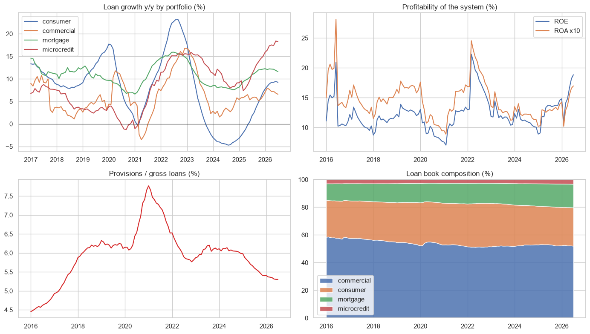
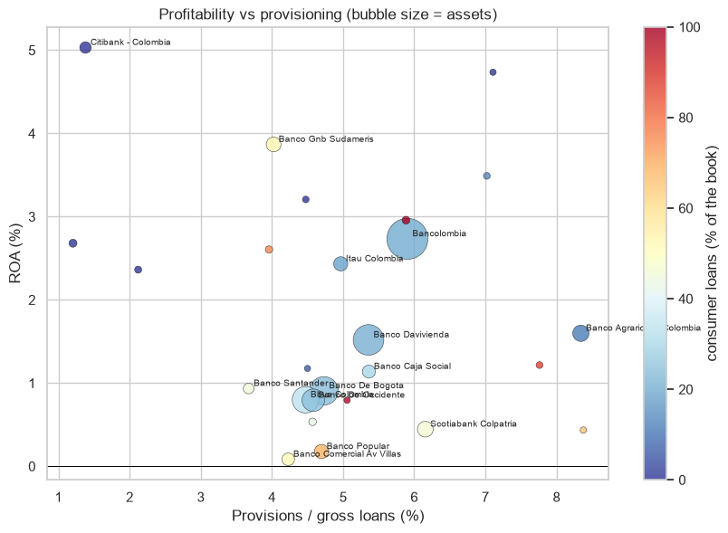

# Colombian banks: profitability, credit risk and business models

A CAMEL-style analysis of the 31 Colombian banks with their monthly financial statements (CUIF), and K-means to group them by business model.

## Data
CUIF of the Superintendencia Financiera (datos.gov.co, `mxk5-ce6w`), 2016 to July 2026.

## Main results
- July 2026: ROA 1.7%, ROE 18.8%, provisions 5.3% of the loans. The 5 biggest banks have 71.5% of the assets.
- Consumer loans grew 23% in 2022, fell 4.7% in 2024 and grow 9.2% today.
- K-means separates traditional retail/commercial banks from wholesale banks (Citibank, JP Morgan, BTG, GNB) with few loans, a lot of liquidity and higher ROA.




## How to run

```
pip install -r requirements.txt
jupyter notebook colombian_banks.ipynb
```

---
Alejandro Lezcano Osorio | Universidad EIA (Colombia) and Rennes School of Business (France)
